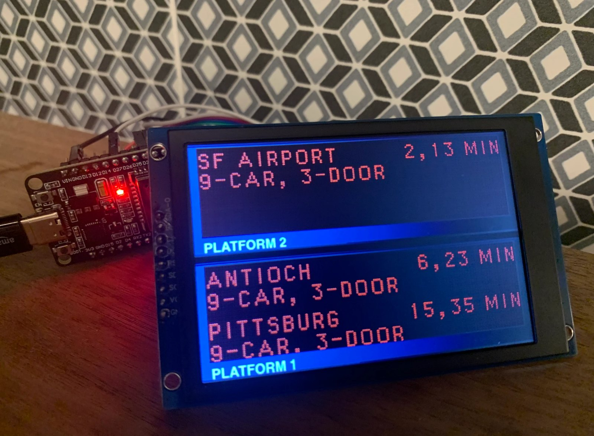
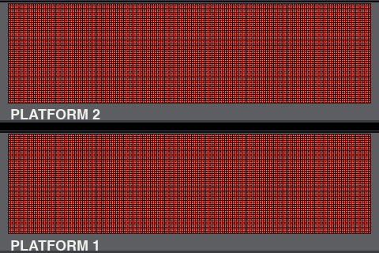
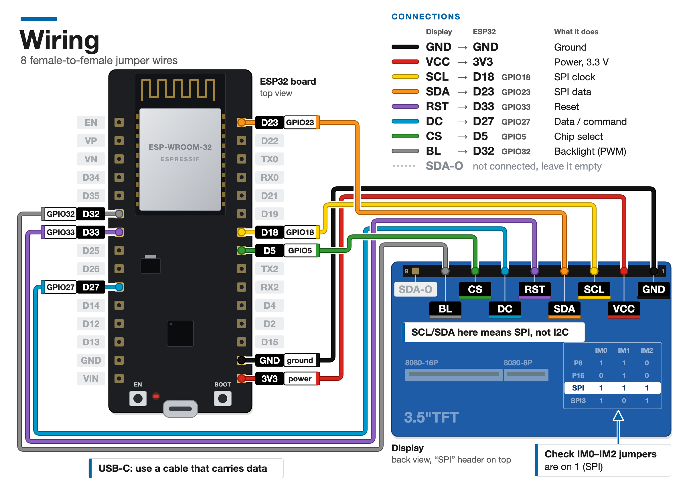
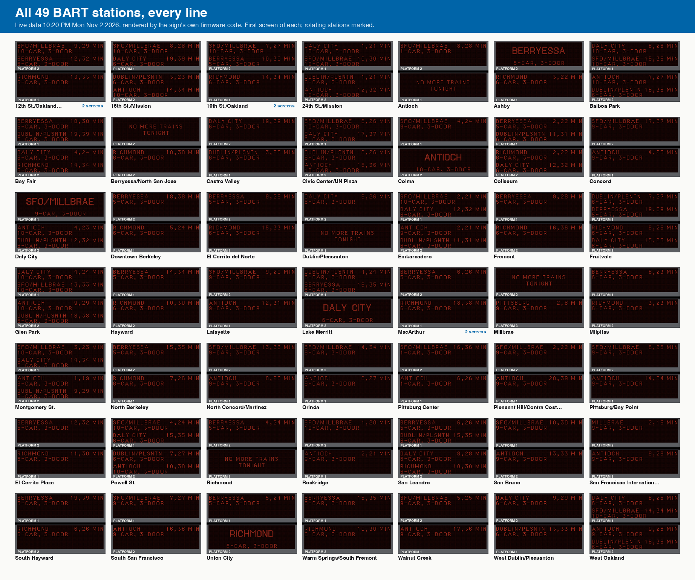

# BART platform sign

A desk-size replica of the red LED departure signs that hang over BART platforms, with live train times.





It runs on a $7 ESP32 board and a 3.5" TFT screen. The screen draws two signs stacked in Lafayette's gray housings, one per platform, and fills them with live departures from BART's public API. Each LED is drawn as a round dot in fonts measured LED by LED from station photos, so "SF AIRPORT 4,12 MIN" looks the way it does on the platform. It costs about $25 a sign. The wiring is eight jumper wires, and you set it up from your phone.

**Full build guide: https://zpg6.github.io/bart-sign/**

## Build one

### Parts

Prices seen on Amazon on 2026-11-02. One order makes two signs.

| Part | Price | Link |
|---|---|---|
| ELEGOO ESP-WROOM-32 USB-C dev board, 3-pack | $19.99 | [B0D8T53CQ5](https://www.amazon.com/dp/B0D8T53CQ5) |
| XIITIA 3.5" SPI TFT, ST7796, 2-pack | $23.99 | [B0DFWL9M9B](https://www.amazon.com/dp/B0DFWL9M9B) |
| ELEGOO 120-piece Dupont jumper wires (you need 8 female-to-female) | $6.98 | [B01EV70C78](https://www.amazon.com/dp/B01EV70C78) |
| USB cable that carries data, USB-C on the board end | | |
| **Total** | **$50.96** | |

That's about $25 per sign. Charge-only USB cables are the most common reason a board "isn't detected". Use one you know moves data.

### Wiring

Eight wires, display header to ESP32 pin. Your board may print the pins as `D18`, `IO18`, `G18` or just `18`. They are the same pin.

| Display | ESP32 |
|---|---|
| GND | GND |
| VCC | 3V3 |
| SCL | D18 |
| SDA | D23 |
| RST | D33 |
| DC | D27 |
| CS | D5 |
| BL | D32 |
| SDA-O | not connected |

The display labels its pins SCL and SDA, but it talks SPI, not I2C. On the back, check that the IM0, IM1 and IM2 jumpers are all on `1`, the SPI setting.



### Quickstart

1. Wire the display as above.
2. Install the tools. Get Rust from [rustup.rs](https://rustup.rs) first. On Linux, also install the build packages listed in the [guide](https://zpg6.github.io/bart-sign/#install-the-tools).
   ```sh
   cargo install espup --locked
   espup install --name esp-1.97 --toolchain-version 1.97.0.0 --targets esp32
   cargo install espflash --locked
   ```
3. Plug in the board and flash it:
   ```sh
   git clone https://github.com/zpg6/bart-sign.git
   cd bart-sign/firmware
   ./flash.sh
   ```
4. On your phone, join the open Wi-Fi network `BART-SIGN-XXXX` that the sign shows. The setup page opens. Pick your 2.4 GHz network, type its password, and choose a station and line.
5. The sign saves, restarts, joins your Wi-Fi and shows trains within a minute.

To start over, hold the board's BOOT button for 5 seconds. The guide covers each step with photos, every screen the sign can show, and [troubleshooting](https://zpg6.github.io/bart-sign/#troubleshooting).

## How it works

- Every 60 seconds the ESP32 asks BART's real-time departures API for your station over HTTPS, with certificate checks. After the last train of the night it asks every 5 minutes instead.
- Between fetches the minutes count down on the board itself.
- [`sign-core`](sign-core/) turns the response into a 176 × 48 LED grid: the four-line list, the big arriving screen, platform rotation at busy stations, and "NO MORE TRAINS TONIGHT". Then it draws each LED as a dot on the 480 × 320 screen.
- The same `sign-core` code renders every image in [`docs/assets`](docs/assets/), so the pictures in the guide are what the firmware draws.
- 36 `sign-core` tests and 15 firmware host tests cover a live snapshot of every station, every line filter, a full night at Lafayette, and every station name in both fonts.



## Point your agent at it

If you use an AI coding agent, have it read [AGENTS.md](AGENTS.md). It lists every command to install, build, flash, check the serial log and run the tests, plus the toolchain traps we hit.

## Repo layout

| Path | What's there |
|---|---|
| `firmware/` | The ESP32 app: Wi-Fi, setup portal, HTTPS fetch, display driver. Rust, `no_std`, Embassy, esp-hal 1.2. |
| `firmware/host-tests/` | Unit tests for the settings record, the setup form and the captive DNS, run on your computer. |
| `sign-core/` | Hardware-free library: API parsing, layout, fonts, boot animation, LED rendering. |
| `tools/` | `render_docs.sh` regenerates every image in `docs/assets`. `build_site.py` builds the website from the guide. |
| `docs/` | The build guide (`guide.md`), its images, and the GitHub Pages site generated from it (`index.html`). |
| `notes/` | Research behind the build: display, fonts, power, parts. See [notes/README.md](notes/README.md). |

## Credits and disclaimer

Departure data comes from BART's [real-time API](https://www.bart.gov/schedules/developers) and is used under BART's [Developer License Agreement](https://www.bart.gov/dla). BART provides it as is, and asks developers for a link back. Thanks, BART.

This is a fan project. It is not affiliated with, sponsored by or endorsed by the San Francisco Bay Area Rapid Transit District. "BART" and the BART logo are trademarks of the San Francisco Bay Area Rapid Transit District.

The fonts were rebuilt from public station photos on Wikimedia Commons, Flickr and bart.gov. The sources are listed in [`notes/`](notes/).

## License

[MIT](LICENSE)
