# Build a BART platform sign

This guide takes you from a bag of parts to a sign on your desk showing live BART departures.

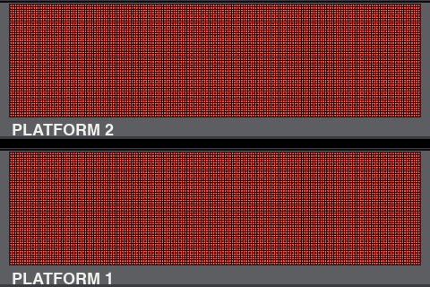

## What it is

If you've waited for a train at a BART station, you know the red LED signs that hang over the platform: "SF AIRPORT 4,12 MIN", then "9-CAR, 3-DOOR" underneath. When a train pulls in, the sign switches to its destination in big letters. This project rebuilds them at desk size:

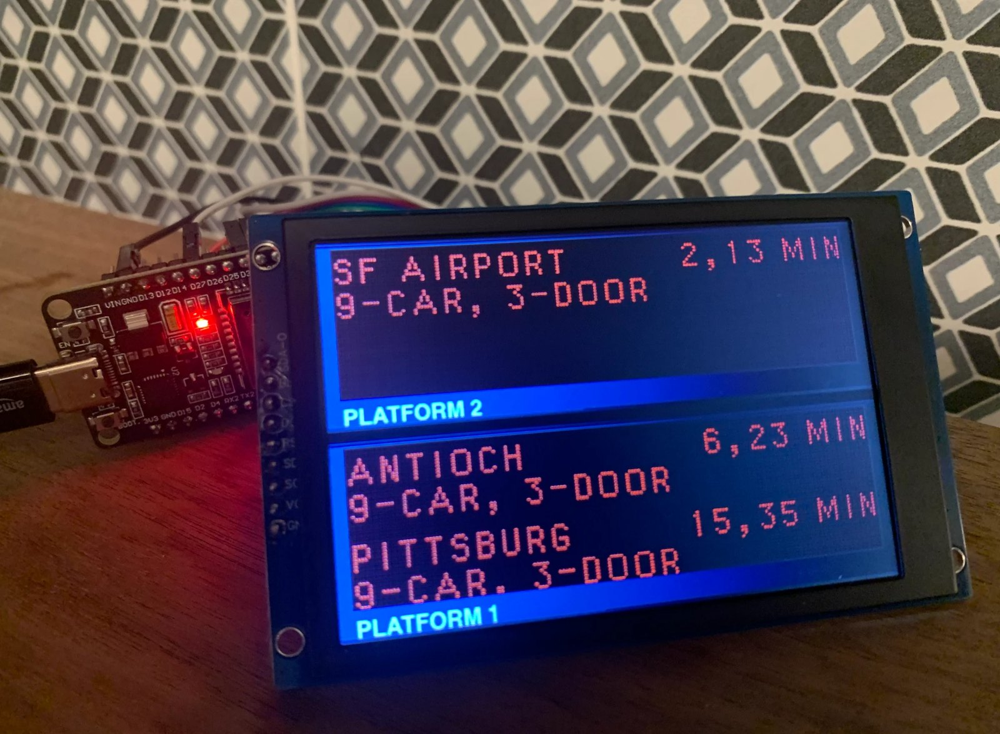

It's modeled on the signs at the stations, if you haven't seen one lately:

, CC BY-SA 4.0, cropped.")
, CC BY-SA 3.0.")

A small ESP32 board connects to your Wi-Fi, asks BART's public API for your station's departures once a minute, and draws them on a 3.5" screen. The screen shows two signs stacked in the gray housings Lafayette station uses, one for each platform. The LEDs are drawn dot by dot, and the fonts were measured LED by LED from station photos, so the text matches the real signs down to their quirks.

You need no electronics experience. The wiring is eight jumper wires. You flash the software from a Mac or Linux computer once, then set the sign up from your phone.

## What you need

### Parts

Prices seen on Amazon on 2026-11-02. This order makes two signs, with a spare ESP32 board.

| Part | Price | Link |
|---|---|---|
| ELEGOO ESP-WROOM-32 USB-C dev board, 3-pack | $19.99 | [amazon.com/dp/B0D8T53CQ5](https://www.amazon.com/dp/B0D8T53CQ5) |
| XIITIA 3.5" SPI TFT display, ST7796, 2-pack | $23.99 | [amazon.com/dp/B0DFWL9M9B](https://www.amazon.com/dp/B0DFWL9M9B) |
| ELEGOO 120-piece Dupont jumper wires | $6.98 | [amazon.com/dp/B01EV70C78](https://www.amazon.com/dp/B01EV70C78) |
| **Total** | **$50.96** | |

That's about $25 per sign. From the wire kit you need 8 female-to-female wires per sign.

This display uses TN glass, so from an angle its blacks and the gray housing tint blue, as in the photo above. An IPS version of the same 3.5" ST7796 panel costs about the same and looks right from any angle; see [notes/sourcing.md](https://github.com/zpg6/bart-sign/blob/main/notes/sourcing.md). It needs one firmware change (color inversion on).

<!-- PHOTO: the parts laid out: ESP32 board, display, 8 wires, cable -->

### Tools

- A Mac or Linux computer. Windows is untested.
- A USB cable that carries data, with USB-C on the board end. **Charge-only cables are the number one reason a board "isn't detected".** If you're not sure about a cable, try another one before anything else.
- A phone, for setup.
- A 2.4 GHz Wi-Fi network. The ESP32 can't see 5 GHz networks.

### Optional

- A USB phone charger, to run the sign away from your computer. It draws well under an amp.
- A case or stand. This repo doesn't include one.

## Wire it

Power everything off (unplugged) while you wire.

Looking at the screen, the display's pin header runs down its left edge, with SDA-O at the top and GND at the bottom. That's the right way up for the sign. The header has nine pins. Connect eight of them to the ESP32 board:

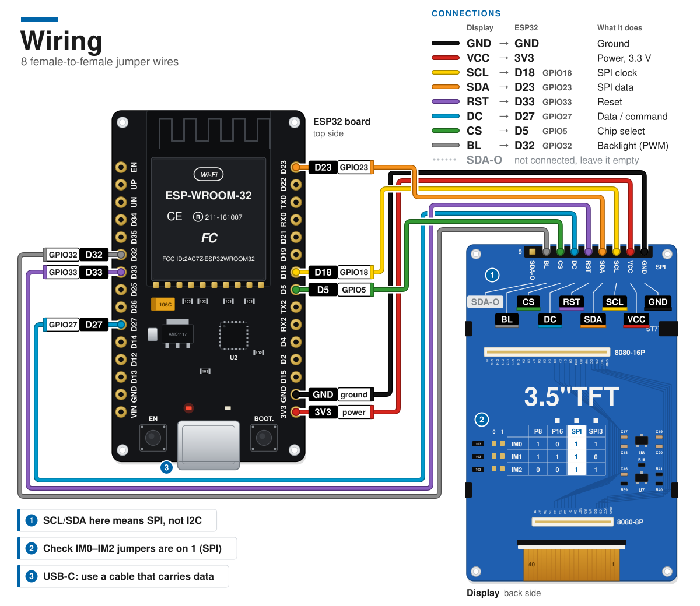

| Display pin | ESP32 pin | What it does |
|---|---|---|
| GND | GND | Ground. Either GND pin on the board works. |
| VCC | 3V3 | Power for the display |
| SCL | D18 | SPI clock |
| SDA | D23 | SPI data |
| RST | D33 | Reset |
| DC | D27 | Data or command |
| CS | D5 | Chip select |
| BL | D32 | Backlight, dimmed at night |
| SDA-O | not connected | Leave it empty |

Your board may print the pins as `D18`, `IO18`, `G18` or just `18`. They are the same pin.

Two things trip people up:

- The display labels its pins SCL and SDA, which sounds like I2C. It is SPI. Wire it exactly as in the table.
- Turn the display over and find the jumper table marked IM0, IM1 and IM2. All three must be on `1`, which is the SPI setting. The boards from the listing above arrive set this way, so this is just a check. They are small solder jumpers, so if yours is set differently you'll need a soldering iron to move it.

Double-check DC. During bring-up, a forgotten DC wire gave a solid white screen.

<!-- PHOTO: display header close-up with the 8 wires attached, labels visible -->
<!-- PHOTO: ESP32 board close-up with the 8 wires attached, pin labels visible -->
<!-- PHOTO: back of the display showing the IM0/IM1/IM2 jumpers set to SPI -->

## Install the tools

The firmware is written in Rust. You install Rust, a Rust compiler for the ESP32's Xtensa CPU, and a flashing tool. You only do this once.

On Linux, first install the build tools espup needs. On Debian or Ubuntu that's `sudo apt-get install -y gcc build-essential curl pkg-config`.

1. Install Rust with the command from [rustup.rs](https://rustup.rs), and accept the defaults:
   ```sh
   curl --proto '=https' --tlsv1.2 -sSf https://sh.rustup.rs | sh
   ```
   Open a new terminal afterwards. If you already have Rust, run `rustup update` instead. espflash needs Rust 1.95 or newer.
2. Install the ESP32 toolchain:
   ```sh
   cargo install espup --locked
   espup install --name esp-1.97 --toolchain-version 1.97.0.0 --targets esp32
   ```
   This downloads the compiler and writes `export-esp.sh` in your home folder (`~/export-esp.sh`). The flash script loads it from there.
3. Install the flashing tool:
   ```sh
   cargo install espflash --locked
   ```
4. Check the versions:
   ```sh
   rustc +esp-1.97 --version   # should end in (1.97.0.0)
   espflash --version          # should be 4.7.0 or newer
   ```

Use exactly `1.97.0.0` and the name `esp-1.97`. Newer pre-release toolchains (1.98, 1.99) build firmware that reboots forever on the ESP32 without printing anything. See [Troubleshooting](#troubleshooting).

## Flash it

1. Download the code:
   ```sh
   git clone https://github.com/zpg6/bart-sign.git
   cd bart-sign/firmware
   ```
2. Plug the ESP32 board into your computer.
3. Build and flash:
   ```sh
   ./flash.sh
   ```
   The first build takes a minute or more while it downloads and compiles libraries. Then espflash finds the board, writes the firmware and opens a serial monitor showing the sign's log.

If espflash asks which port to use, pick the one that appeared when you plugged the board in. On a Mac it looks like `/dev/cu.usbserial-XXXX`, on Linux `/dev/ttyUSB0`. You can also name it up front:

```sh
ESPFLASH_PORT=/dev/cu.usbserial-XXXX ./flash.sh
```

On Linux, a "Permission denied" error means your user can't open the port yet. Run `sudo usermod -a -G dialout $USER`, log out and back in, and try again.

If espflash sits at `Connecting...`, put the board into download mode by hand. Hold the **BOOT** button, press and release **EN**, then let go of BOOT once writing starts.

It worked if espflash prints `Flashing has completed!` and, a few lines into the log below it, `bart-sign: boot`. The screen runs its lamp test and a short intro, then the top sign shows JOIN WI-FI (next section). Press `Ctrl+C` to close the monitor. The sign keeps running.

If you change the code later, run `./flash.sh` again. Reflashing keeps your Wi-Fi and station settings.

## Set it up

A new sign has no Wi-Fi settings, so it starts its own open Wi-Fi network and asks you to join it. The top sign shows:

```
JOIN WI-FI
BART-SIGN-XXXX
OPEN 192.168.4.1
```

`XXXX` is four characters unique to your board.

<!-- PHOTO: the sign showing JOIN WI-FI / BART-SIGN-XXXX / OPEN 192.168.4.1 -->

On your phone:

1. Open Wi-Fi settings and join **BART-SIGN-XXXX**. It has no password.
2. A setup page titled **Set up your sign** pops up. If it doesn't, open a browser and go to `http://192.168.4.1`.
3. **Wi-Fi network:** pick your network from the list. The list only shows 2.4 GHz networks the sign can hear, strongest first. Picking from the list avoids typos like a lowercase `l` typed as a capital `I`, which happened during bring-up. If your network is hidden, type its name in the box below the list.
4. **Password:** type your Wi-Fi password. Tap **Show password** to check it. Leave it empty for an open network.
5. **Station:** pick your station. All 50 are listed. The default is Lafayette.
6. **Line:** the page starts on Yellow, Lafayette's line. Pick **All lines** to see every train, or one line: Yellow, Red, Green, Orange or Blue. With one line picked, the sign only shows that line's trains.
7. Tap **Save and connect**. If something is off, such as a password shorter than 8 characters, the page says what to fix.

<!-- PHOTO: phone screenshot of the setup page -->

The sign shows `SAVED / RESTARTING`, restarts, and joins your network. The setup network disappears, and your phone goes back to its usual Wi-Fi. The intro plays again, this time with your station's name on the bottom sign. Within a minute it gives way to trains.

The sign works with WPA2 password networks and open networks. Networks that need a username (enterprise Wi-Fi) or a sign-in page (hotels, cafes) won't work.

## Reading the sign

Each picture below is rendered by the sign's own drawing code, from real BART data. The top sign shows the platform whose trains BART lists as southbound. At Lafayette that's platform 2, toward San Francisco and SFO. The bottom sign shows the other platform. The label under each sign names the platform its trains are using.

### Boot

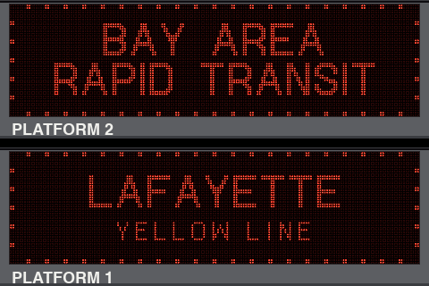

Both signs run a lamp test: every LED on, then dark from the top down. A dotted border builds around each sign. Then the top sign types BAY AREA over RAPID TRANSIT in the big arriving font, and the bottom sign types your station's name on the same beat, finishing with it. The line name appears underneath. Before setup there's no station yet, so the bottom sign copies the top one. Departures replace the intro as soon as the first fetch lands.

### Departures

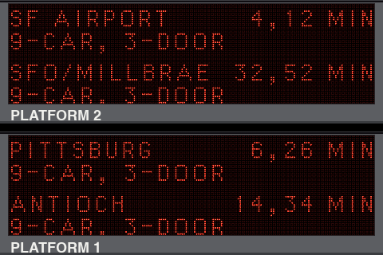

The usual screen. Each sign lists up to two destinations, soonest first. Each destination gets two lines: the name with the next one or two trains ("4,12 MIN"), then the train length ("9-CAR, 3-DOOR").

BART's last two-door legacy train left regular service in September 2023. Every car in service since then has three doors per side, so the sign always says 3-DOOR. The API reports cars, not doors.

Look closely at the bottom line: "9-CAR. 3-DOOR" with a period. That's on purpose. On the real signs that line sits on the last row of LEDs, which cuts off the comma's tail.

Between fetches, the minutes count down on the sign itself. The countdown stops at 1 MIN. Only BART's own report puts a train at the platform.

### Train at the platform

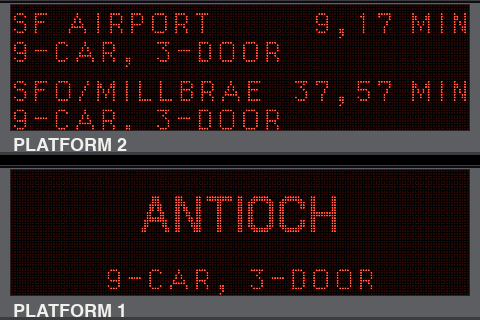

When BART reports a train at the platform, that sign switches to the destination in big letters with the car count below. Long names split over two lines, like PITTSBURG / BAY POINT.

### Busy stations rotate

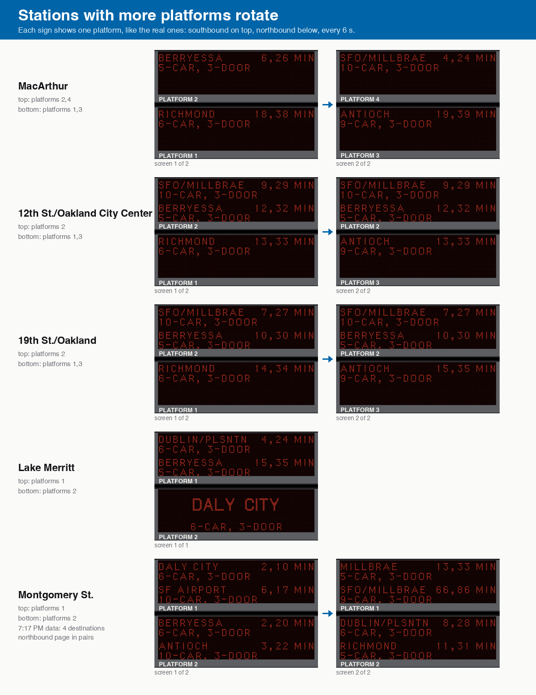

Real BART signs show one platform each. Most stations have two platforms, so each sign gets one. MacArthur has four and 12th St and 19th St have three. There, each sign takes the platforms whose trains run its way and cycles through them every 6 seconds. The platform label changes with them.

A platform with more than two destinations pages through them two at a time. Montgomery St at rush hour has four northbound:

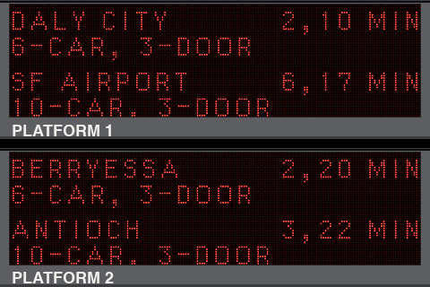
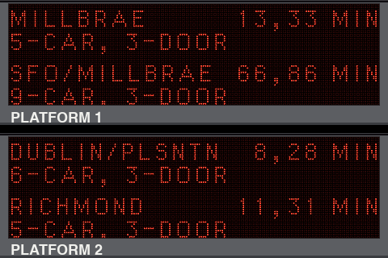

If two trains are at the platforms at once, the big arriving screens alternate.

### Late at night

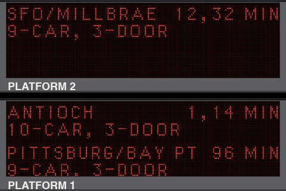

Late in the evening the gaps get long. This is Lafayette at 11:17 PM. The sign shows what BART reports, even a 96-minute wait.

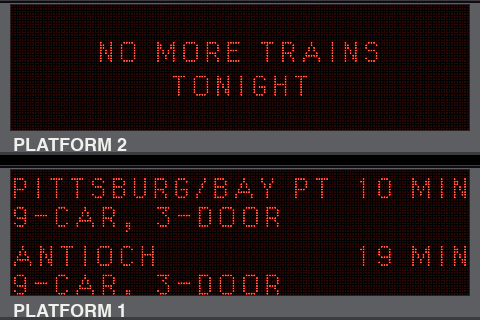

From 9 PM to 5 AM by BART's clock, a platform with no more trains shows NO MORE TRAINS / TONIGHT. This is Lafayette at 12:47 AM. The other sign keeps running until its last train.

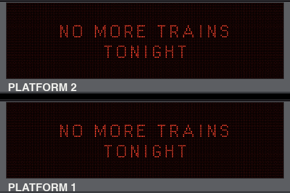

When both platforms are done (here, 1:17 AM), the backlight dims to a faint glow, like a sign in a closed station. The sign checks every 5 minutes instead of every minute, and brightens with the first trains of the morning.

During the day, a sign with nothing to show says NO TRAINS. You'll also see that if the line you picked doesn't stop at your station, or if you picked Oakland International Airport, which BART's departure feed doesn't cover.

### Every station

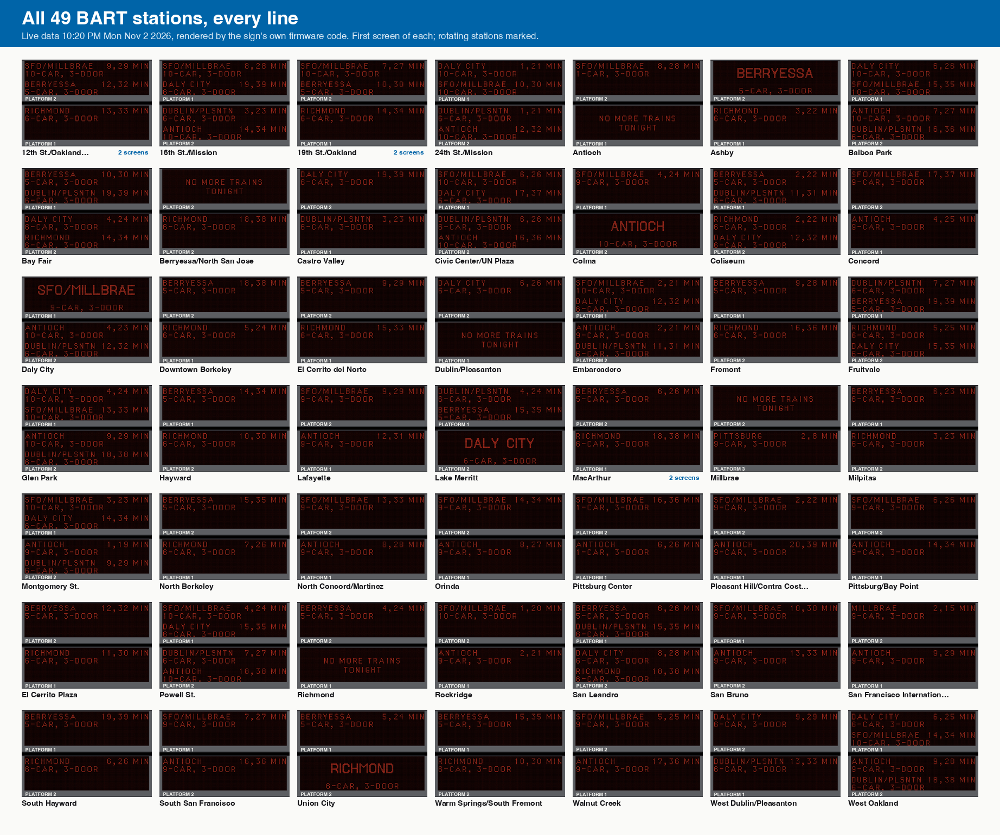

The first screen at every station, from live data at 10:20 PM on Nov 2, 2026. Oakland Airport is the one station missing, because the feed has no departures for it.

Every station name, as a destination in the list font and in the big arriving font:

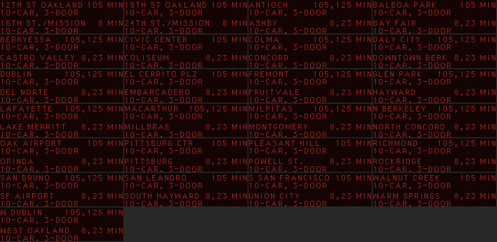
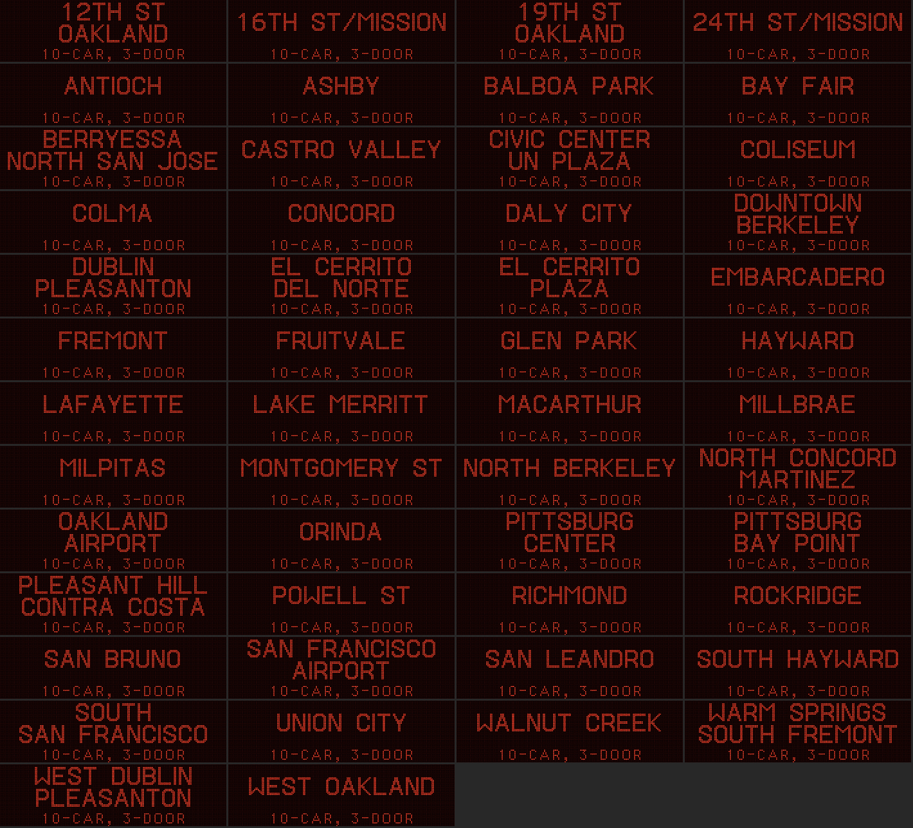

### Status messages

Status messages take over the top sign. The bottom sign goes dark.

| Message | Meaning |
|---|---|
| JOIN WI-FI / BART-SIGN-XXXX / OPEN 192.168.4.1 | Setup mode. See [Set it up](#set-it-up). |
| SAVED / RESTARTING | Settings saved. |
| CONNECTING TO / *your network* | Joining Wi-Fi. During boot it only appears if joining takes more than 20 seconds. After a dropout, the departures stay up until they're 3 minutes old, then this appears. |
| CONNECTED / LOADING TRAINS | On Wi-Fi, waiting for the first departures. |
| CAN'T JOIN / *your network* / HOLD BOOT 5S: RESET | Three tries failed. The sign keeps trying. See [Troubleshooting](#troubleshooting). |
| HOLD 5 S TO / RESET WI-FI | You're holding BOOT. Keep holding to reset, or let go to cancel. |
| WI-FI RESET | Settings erased. The sign restarts in setup mode. |

## Resetting, moving or changing station

The settings are your Wi-Fi network, password, station and line. To change any of them, start over:

1. Hold the **BOOT** button on the ESP32 board.
2. After a second the sign shows `HOLD 5 S TO / RESET WI-FI`. Keep holding.
3. At 5 seconds it shows `WI-FI RESET` and restarts.
4. Let go and follow [Set it up](#set-it-up) again.

Let go before 5 seconds to cancel.

This erases the Wi-Fi password too, so have it handy. Moving the sign to a new home works the same way.

If the sign can't join your network, it never erases the settings on its own. Your router might just be down. It keeps retrying, and you decide when to reset.

## Troubleshooting

### No serial port appears / board not detected

Almost always the cable. Many USB-C cables only charge. Try a different cable, ideally one you've used to move files. Then try another USB port.

On a Mac the board appears as `/dev/cu.usbserial-XXXX`, on Linux as `/dev/ttyUSB0`. Run `espflash list-ports` with the board plugged in.

### espflash hangs at "Connecting..."

Hold **BOOT**, press and release **EN**, and let go of BOOT once writing starts. Run `./flash.sh` again if it timed out.

### Solid white screen

The display has power but isn't getting commands. In bring-up this was a forgotten DC wire. Check DC to D27 first, then the other signal wires (SCL, SDA, CS, RST), then that the IM jumpers are on SPI.

### Black screen

Check BL to D32 (the backlight), and VCC to 3V3 and GND to GND.

### The board reboots over and over and the log is empty

Wrong toolchain. The 1.98 and 1.99 pre-release Xtensa toolchains miscompile the ESP32's startup code. The chip hangs before the firmware starts, the watchdog resets it, and it repeats forever. Check:

```sh
rustc +esp-1.97 --version
```

It must end in `(1.97.0.0)`. If not, rerun the `espup install` command from [Install the tools](#install-the-tools), then flash again.

### Build error: "custom toolchain 'esp-1.97' ... is not installed"

The toolchain was installed under another name. Rerun `espup install` with `--name esp-1.97` exactly as shown.

### Build error: "Xtensa linker ... was not found in PATH"

The compiler paths aren't loaded. `flash.sh` loads them from `~/export-esp.sh`. If you told espup to write the file elsewhere, point to it:

```sh
ESP_EXPORT=/path/to/export-esp.sh ./flash.sh
```

### Old espflash

You need espflash 4.7 or newer. Version 4.1 ships an older second-stage bootloader. Upgrade:

```sh
cargo install espflash --locked --force
```

### My network isn't in the list

- The sign only sees 2.4 GHz. If your router uses separate names for 2.4 and 5 GHz, pick the 2.4 GHz one. If it combines them under one name, that's fine.
- The list comes from a scan when the sign starts. Move the sign closer to the router, unplug it, and plug it back in to scan again.
- For a hidden network, type the name in the box under the list.

### CAN'T JOIN

The sign tried three times and failed. Common causes:

- Wrong password. Use **Show password** on the setup page to check it.
- A typo in the network name, such as a lowercase `l` for a capital `I`. Pick the network from the list instead of typing it.
- A 5 GHz-only network.
- The sign is too far from the router.

Hold BOOT for 5 seconds and set it up again.

If the serial log shows one `AuthenticationFailed` right after a restart and then connects, that's normal. Some routers refuse the first attempt because they still remember the board's previous session. The firmware retries after half a second.

### The setup page doesn't pop up

Stay connected to BART-SIGN-XXXX and open `http://192.168.4.1` in your phone's browser. If your phone warns that the network has no internet, choose to stay connected.

### NO TRAINS all day

- The line you picked doesn't stop at your station. Reset and choose **All lines**.
- You picked Oakland International Airport. BART's departure feed has no trains for it.

### The screen stopped changing

While trains are listed, the minutes change every minute. If they stop changing, the firmware has stopped. Unplug the sign and plug it back in. Your settings stay. If it happens again, run the sign from your computer with `espflash monitor` open, and when it freezes, look for `PANIC` in the log.

### Departures stopped everywhere

When fetches keep failing, the trains count down and drop off one by one until the sign says NO TRAINS. The serial log shows `fetch_etd failed`.

The firmware uses BART's public API key. BART says it may change that key, and recommends registering your own at [bart.gov/schedules/developers/api](https://www.bart.gov/schedules/developers/api). To use your own key, replace the key in `PATH_END` in `firmware/src/net.rs` and flash again.

### The sign doesn't power from a USB-C charger

Some ESP32 boards lack the resistors a USB-C charger looks for before it supplies power. Try a USB-A charger with a USB-A to USB-C cable.

## How it works


### Data

Once a minute the ESP32 requests `https://api.bart.gov/api/etd.aspx?cmd=etd&orig=<station>&key=<key>&json=y`, BART's real-time departures. The connection uses TLS with full certificate checks: chain, signature and hostname. The sign has no clock, so certificate dates aren't checked. The trusted root certificates are in `firmware/certs/`.

If a fetch fails, the sign waits longer before the next try: 2 minutes, then 4, then 5 at most. Each wait gets a little random jitter. Once service is over for the night, it checks every 5 minutes.

The response is parsed in `sign-core/src/etd.rs`. Trains are grouped by destination and platform, and cancelled trains are dropped like on the real signs. The time of night comes from BART's own clock in the response, so the sign needs no time zone setting.

### Drawing

`sign-core` is a library with no hardware code. It lays out a 176 × 48 LED grid, the size of the real sign, which was measured from a photo of one showing random noise. `board.rs` decides which platform goes on which sign. `layout.rs` places the text and shortens long names the way BART does ("MILLBRAE/CALTRN", "PITTSBURG/BAY PT"). `render.rs` turns each LED into a round dot, 2.6 pixels apart, with a bright core and a dim rim.

On the ESP32, `firmware/src/sign.rs` draws the housings once and then repaints only the LED rows that changed, over a 40 MHz SPI bus.

### Fonts

The sign uses two fonts: a small one 8 LEDs tall for lists and a big one 14 LEDs tall for arriving trains. Two independent studies measured them LED by LED from station photos on Wikimedia Commons, Flickr and bart.gov, and the results were reconciled. The details, with every source, are in `notes/font-measurements-a.md` and `notes/font-measurements-b.md`.

### Tests

- `sign-core`: 36 tests. They run every station's live snapshot through every line filter and every page, a full night of Lafayette snapshots, and every station name in both fonts, checking that text stays on the sign.
- Firmware host tests: 15 tests for the settings record in flash, the setup form and the captive-portal DNS.

CI runs both on every push and builds the firmware.

### Proof images

Every image in this guide comes from `tools/render_docs.sh`, which runs the same `sign-core` drawing code the firmware uses on the saved API responses in `sign-core/tests/fixtures/`. Rerunning it on unchanged code produces identical files.

## Credits

Departure data comes from BART's [real-time API](https://www.bart.gov/schedules/developers), used under BART's [Developer License Agreement](https://www.bart.gov/dla). BART provides the data as is and asks developers for a link back. Thanks, BART.

This is a fan project. It is not affiliated with, sponsored by or endorsed by the San Francisco Bay Area Rapid Transit District. "BART" and the BART logo are trademarks of the San Francisco Bay Area Rapid Transit District.

The fonts were rebuilt from public station photos. Photographers and sources are credited in `notes/`.

The two photos of real station signs in this guide are by Scott Feeney (16th St Mission, [CC BY-SA 4.0](https://creativecommons.org/licenses/by-sa/4.0/)) and Pi.1415926535 (SFO, [CC BY-SA 3.0](https://creativecommons.org/licenses/by-sa/3.0/)), from Wikimedia Commons. They keep their own licenses, not the project's MIT license. Details are in [docs/assets/reference/CREDITS.md](https://github.com/zpg6/bart-sign/blob/main/docs/assets/reference/CREDITS.md).

Code: [github.com/zpg6/bart-sign](https://github.com/zpg6/bart-sign), MIT license.
